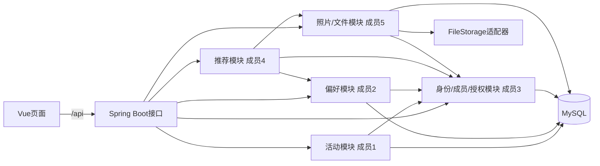

# 技术架构与模块边界

状态：**启动架构建议**。技术栈用于基础工程；业务接口、实体和授权语义仍需团队评审。当前实现范围以根 README 和验证记录为准，本文中的模块职责不是已实现功能。

## 技术选择与成本控制

| 层 | 选择 | 原因和限制 |
|---|---|---|
| 前端 | Vue 3、TypeScript、Vite、Vue Router、pnpm；Node 24 | 单页面应用；只保留一个应用，不引微前端；接口通过 `/api` 调用 |
| 后端 | Spring Boot 3.5、Java 21目标、Maven | 单进程模块化单体；成员4的算法作为纯Java代码被服务调用，不增加Python服务 |
| 数据库 | MySQL 8.4 | 业务数据统一关系型存储；demo/test用H2快速启动，方言和约束仍须在MySQL验证 |
| 文件 | 私有文件存储接口，目标MinIO适配器 | 图片不存数据库BLOB；接口隐藏本地文件与对象存储差异 |
| API | REST、JSON、OpenAPI草案 | 先约定输入输出和错误，再并行开发；健康接口以实际测试为准 |
| 环境 | Docker Compose、GitHub Actions | Compose管理MySQL及可选应用；只做需要的服务，暂不引Redis、MQ、Kubernetes |

MinIO公共镜像的可获取性正在核实，不把不明镜像当作已验证依赖。默认工程不强制启动MinIO；可选 `docker-compose.storage.yml` 需提供经过验证的 `MINIO_IMAGE`。第二周可先用开发机私有目录中的本地适配器验证上传和缩略图，MinIO连通性单独记录，不能以本地文件测试代替对象存储联调。客户端不应拿到存储管理员凭证。

## 请求链和依赖



依赖服务接口，不跨模块直接修改另一模块的数据。推荐模块只能读取成员、偏好和经过服务端核验的候选照片，不能改写授权。文件模块负责字节和元数据，最终访问决定由权限策略作出。

## 代码组织

```text
frontend/src/
  api/              # API客户端、类型和错误处理
  router.ts         # 基础路由
  views/            # 当前主页、健康页；业务模块需要时再创建
backend/src/main/java/com/groupphoto/consensus/
  health/           # 当前基础健康接口
docs/               # 需求、边界、分工和任务
scripts/            # 统一开发与检查入口，详见README
.github/            # CI和协作模板
```

业务代码按需放入 `event`、`preference`、`membership`/`authorization`、`recommendation`、`photo`，各自按需要组织 controller/application/domain/infrastructure。前端按业务页新增 `features/events`、`features/photo-review` 等；不用一开始就建立全套空目录。共享代码改动通过接口Issue协调，不要求五人各写一套公共工具。

## 接口约定

- 当前健康接口：`GET /api/health`，响应 `{"status":"UP","application":"group-photo-consensus"}`。它只证明应用可响应；`/actuator/health/readiness`另检查当前配置数据库，demo下检查的是H2，不代表MySQL已验证。
- 开发时Vite代理 `/api` 到本机8080；正式同源反向代理由Compose应用配置处理。前端不要硬编码后端域名。
- 业务接口使用JSON，资源ID用字符串表达，时间用UTC ISO 8601，枚举固定大小写。错误拟采用Problem Details结构，不把异常栈返回给客户端。
- 资源接口必须做活动成员检查；`userId`来自服务器认证上下文，不信任前端提交的操作者ID。身份方案尚待确认；第二周单元/接口测试可使用测试认证上下文，模拟身份不能作为可对外开放的登录功能。
- 草案见 [API契约](api/openapi.yaml)。`x-implementation-status: planned` 的接口只用于讨论、模拟及测试设计，不能宣称已可调用。

## 数据边界草案

| 模块/写入负责人 | 候选实体 | 关键约束 |
|---|---|---|
| 成员1 | Event | 活动名称非空；创建者来自认证上下文；状态和选片数量受校验 |
| 成员3 | User、EventMember、Invitation | 活动与用户唯一成员关系；邀请令牌只存摘要，需到期/撤销；系统管理员与活动角色分开 |
| 成员5 | Photo、PhotoVersion、PhotoSubject、StoredObject | PhotoVersion不可变；照片属于一个活动；对象键使用服务端随机ID，不使用原始路径 |
| 成员2 | Preference | 用户、照片版本唯一；修改不产生授权变化 |
| 成员3 | PublicationConsent | 用户、照片版本、用途唯一；状态为PENDING/ALLOW/DENY；变更保留审计信息 |
| 成员4 | SelectionRequest、SelectionItem | 记录请求用途和选中版本、规则/数据快照；不是授权凭证 |
| 成员5（经策略检查） | ExportTask | 精确版本列表；生成前再次检查权限与授权，不返回任意对象键 |

这不是最终ER图或满足数量要求而凑出的已实现类。第二周先建立所需的最少业务表，使用评审后的迁移脚本；业务键加唯一约束、关系加外键/一致性校验、经常按活动过滤的列建索引。禁止共享root数据库账户，禁止手改已应用迁移；测试包含跨活动访问和重复提交。

## 授权与图片版本：先确定的不变量

1. **偏好与发布授权分表、分接口。** 喜欢照片不能推导同意公开。
2. 授权绑定 `actorId + photoVersionId + purpose`，并校验出镜人员集合是否仍是确认时的集合。发布/导出用途枚举先暂定 `INTERNAL_SHARE`、`PUBLIC_POST`，待访谈确认；原图存储始终私有。活动内预览与对外分享是不同权限，内部预览的可见范围也需确认，不能把能预览当成能发布。
3. 版本或标记集合发生变化，新授权上下文默认PENDING。旧记录保留用于追溯，但不能自动给新版本放行。
4. 明确DENY或缺少必需的ALLOW都不能入选可发布集合。谁需要授权由已确认的规则决定，漏标争议未解决时阻止导出，不能假定无人反对。
5. 推荐和导出各做一次服务端检查。导出必须对精确版本、用途和当前授权再次核验；授权变化则终止/重新确认，防止先推荐后撤回仍被导出。
6. 发起人和系统管理员不能代签个人发布授权。缩略图、原图下载及对象链接也必须遵守成员可见范围。

这些是保守的启动安全边界。撤回对已导出的文件有何效力、授权主体与展示细节仍需真实用户确认，系统不能承诺收回已下载到外部的副本。

## 推荐算法起步范围

第二周只实现可用模拟数据运行的确定性Java算法，不做复杂优化器。输入包括活动成员、精确照片版本、指定用途、目标数量、完整模拟评分、服务端授权过滤结果；输出选中版本、成员效用、限制原因和未满足数量。缺失评分策略待确认，第二周测试样例先提供完整评分，不伪装成真实用户偏好。无出镜者是否参与效用计算同样待确认；模拟样例先固定参与计算的成员集合，不据此做业务定论。

候选方法：先排除DENY/PENDING、版本已过期和无权访问的照片，再用贪心方式逐张选择，使当前成员最低归一化效用优先改善；同分比较总效用，再按照片版本ID稳定排序。它是待验证启发式，不能宣称全局最优或保证所有人满意。数量不足必须返回不足原因，不得放宽授权。用偏向多数、偏向少数、全拒绝、并列和不足等构造样例比较普通总分排序。

样例中暂以评分`-1/0/1`映射到`0/0.5/1`，个人效用定义为所选照片映射分数的平均值；空集合效用记0。每一步先比较全体样例成员的最低效用，再比较总效用。该定义仅是可以被测试的讨论起点，评分档位与正式公平目标仍需用户和团队确认。

## 工具参考

- [Spring Boot 3.5 系统要求](https://docs.spring.io/spring-boot/3.5/system-requirements.html)
- [Vite 入门与 Node 版本要求](https://vite.dev/guide/)
- [GitHub 分支保护与套餐限制](https://docs.github.com/en/repositories/configuring-branches-and-merges-in-your-repository/managing-protected-branches)
