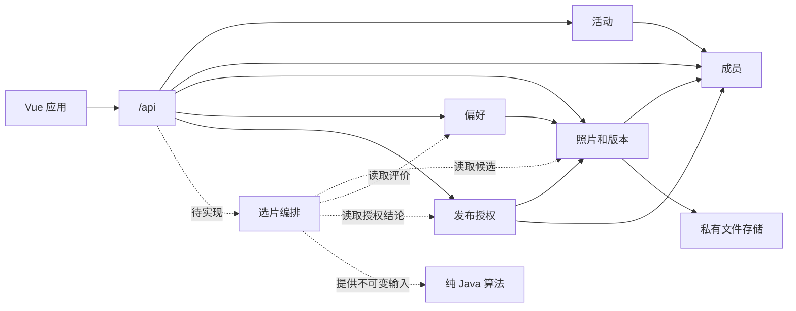

# 技术架构与模块边界

照有商量采用 Vue 3 + TypeScript 前端和 Spring Boot 3.5 模块化单体。前后端同仓库、独立构建，通过 `/api` 对接。Vite 用于本机开发，Compose 的应用配置使用 Nginx 转发。后端以 Java 21 为编译目标，推荐算法也使用 Java。

数据库迁移统一由 Flyway 执行。H2 用于开发演示和测试，MySQL 8.4 用于持久化。图片与缩略图写入服务端私有目录，数据库记录归属、版本和存储元数据。MinIO Compose 配置用于单独实验，实际接入需提供适配器及独立验证。

## 模块和调用方向

活动用例在创建活动的同一事务内写入发起人成员关系。成员资格和角色判断集中在 `membership`，该模块维护成员数据，避免反向依赖活动用例。照片模块负责照片归属、不可变的媒体版本、出镜名单修订和文件流。偏好与授权以已校验的照片版本和名单快照作为输入。授权策略不回调照片服务，纯算法只处理由应用用例准备好的输入。

前端各业务功能需要时新增 `features/events`、`features/photo-review` 等目录。已有 `views/` 提供主页和健康页，`api/` 承载共享请求工具。后端直接在 `com.groupphoto.consensus` 下按 `identity`、`event`、`membership`、`photo`、`preference`、`authorization`、`recommendation` 分包，多个功能共用的契约改动由消费者参与评审。

## API 与持久化约定

- [OpenAPI](api/openapi.yaml) 中的 `implemented` 表示当前联调入口，`planned` 表示接口草案。
- 业务请求使用显式 Bearer 头。当前联调身份由服务端配置，客户端不能指定操作者或其角色。正式登录和邀请流程待团队选型。
- 业务错误使用 `application/problem+json`。未提供有效身份返回 `401`，活动成员或角色不足返回 `403`，资源不存在或不属于路径指定活动返回 `404`，名单修订过期返回 `409`。
- 每个表保持清楚的写入归属。合入后的 Flyway 文件保留，新增变更使用下一版迁移。写入同时校验活动、照片及媒体版本的归属，数据库外键和唯一约束负责守住基本一致性。
- 业务文件限定 JPEG/PNG，单文件最多 8 MiB，单次请求最多 9 MiB。服务端先核对格式、尺寸与像素上限，再解码和生成缩略图。成员通过受保护的接口读取缩略图。

| 数据 | 写入归属 | 关键规则 |
|---|---|---|
| 活动 | 活动模块 | 创建活动与写入发起人成员关系同事务 |
| 成员 | 成员模块 | 一个用户在同一活动只有一条成员记录，角色仅在活动内生效 |
| 照片、版本、出镜名单 | 照片模块 | 照片属于一个活动，版本属于一张照片，名单变化递增 `subjectRevision` |
| 偏好 | 偏好模块 | 当前用户和照片版本唯一，未评分独立于评分 `0` |
| 发布授权 | 授权模块 | 当前用户、照片版本、用途和名单修订唯一 |
| 选片结果与导出 | 待开发 | 保存准确照片版本和用途，供后续复核和追溯 |

## 照片授权

首次上传后名单处于未确认状态。发起人提交名单时携带其看到的 `subjectRevision`，名单变化后使用新的修订号。明确确认空名单也会形成已确认的上下文。参与者提交授权时携带同一修订号，过期请求返回 `409` 并提示刷新。

授权用途采用 `INTERNAL_SHARE` 和 `PUBLIC_POST`。允许活动内查看缩略图属于成员访问权限。发布候选必须有已确认的名单，且名单内每个人都对该版本、用途和修订明确同意。拒绝或未确认时排除照片，不公开是谁拒绝。实际导出接口开发时还要在交付文件之前复核最新授权。

## 推荐开发起点

现有策略基线用于判定候选是否满足授权条件。成员 4 接着实现选片用例和结构化解释。应用用例先校验访问范围，并为每个可见版本取得授权结论，再把包含该结论在内的不可变候选、偏好和目标数量交给纯 Java 算法；授权过滤与排除计数由 `CandidateFilter` 一次完成，不在应用层预先剔除被拒照片，以免丢失 `AUTHORIZATION_REQUIRED` 等计数。候选不足时返回实际数量和汇总原因码。公开结果应只展示人数、分布或汇总效用等经过确认的指标。算法输入输出与校验规则见 [推荐输入输出契约](api/recommendation-dto.md)。

对算法作业，可先用完整的模拟评分比较贪心方案和按总分排序。尝试优先改善最低个人效用，同分比较总效用，再用版本 ID 稳定排序。未评分处理、效用定义和目标权重由成员 4 提案，经团队评审确认。正式用例见 [选片接口草案](api/openapi.yaml)。
