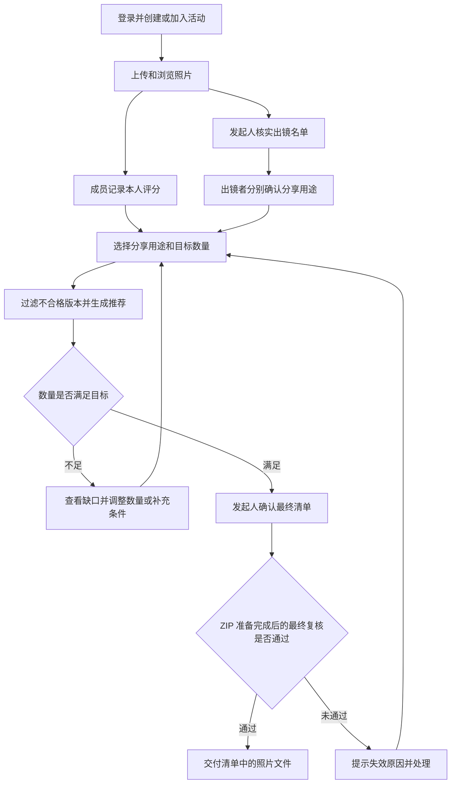

# 照有商量 · 软件需求规格说明书

| 文档信息 | 内容 |
|---|---|
| 项目名称 | 照有商量 · Frame & Say |
| 修订日期 | 2026 年 11 月 27 日 |
| 本次修订负责人 | 郭炫君（lzndXJ） |
| 关联任务 | [需求与交付计划 #19](https://github.com/Jdeciderz23/frame-and-say/issues/19)、[需求评审 #7](https://github.com/Jdeciderz23/frame-and-say/issues/7) |

## 1 引言

### 1.1 编写目的

本说明书约定「照有商量」需要提供的功能、使用规则、质量要求和交付边界，供组员讨论需求、开展建模、实现功能和设计测试时共同使用。阅读后，团队应当对“用户可以做什么、系统怎样响应、什么情况下不能继续、怎样判断功能完成”形成一致理解。

本文约定目标系统的业务行为和验收条件。实现进度和测试结果由关联 Issue、PR 及验证记录维护。

### 1.2 编写依据与阅读关系

课程依据为《第03课－学生讲解项目需求》第 1 页：功能需求应有用例编号、描述和验收标准，另须说明非功能需求与约束条件，并提供完整用例图、场景描述、追溯矩阵及变更记录。《软件工程课程设计要求－版本2》第 2 页规定了用例数量、角色、权限和外部集成点等项目规模要求。

项目内各文档的关系如下：

| 文档 | 回答的问题 | 与本说明书的关系 |
|---|---|---|
| [需求调研报告](10-research-report.md) | 用户遇到了什么问题，需求依据是什么 | 为需求提供背景与依据 |
| [用户故事清单](09-user-stories.md) | 用户希望完成什么，为什么要完成 | 本文在故事基础上细化系统行为 |
| 本说明书 | 系统应当提供什么，规则和验收条件是什么 | 供建模、开发与测试共同遵循 |
| [系统用例图](12-use-case-diagram.md) | 哪些参与者使用哪些功能 | 与第 4 节的 UC 编号对应 |
| [需求追溯矩阵](13-traceability.md) | 每项需求对应哪个用例、Issue、负责人和增量 | 保持现有编号及团队分工 |
| [API 契约](api/openapi.yaml)与[技术架构](03-architecture.md) | 接口、数据和技术模块怎样协作 | 承接需求，不代替需求正文 |

US 表示用户故事来源编号，UC 表示系统用例编号，NFR 表示非功能需求编号。本次修订沿用原有 US-01～US-24、UC-01～UC-24 和 NFR-01～NFR-04，不重新分配需求编号。

## 2 系统概述

### 2.1 项目背景与目标

旅行、聚会或社团活动结束后，照片通常分散在多位成员的手机和聊天记录中。组织者需要收集照片、征求意见，再选出一组适合分享的照片。成员对同一张合照的看法可能不同，认为“拍得好看”也不等于愿意公开发布；照片经过裁剪或修改后，原先的同意还可能失去适用条件。

「照有商量」以一次活动为单位，把照片整理、个人评分、分享确认和最终选片放在同一条业务流程中。系统的目标是：

1. 让参与同一次活动的人在同一处上传、浏览和评价照片，减少反复找图、询问和汇总的工作。
2. 让出镜者分别决定照片能否用于群内分享或公开发布，保证个人偏好与分享许可各自独立。
3. 从符合分享条件的照片中给出兼顾成员偏好的组合，解释入选结果和数量不足的原因。
4. 让最终交付对应成员实际确认过的照片版本和用途，并在下载前再次检查最新条件。

### 2.2 项目范围与交付安排

首版面向一次约 5～10 人的小规模活动，通过浏览器使用。人数是设计和验收规模，不表示活动必须凑齐 5 人才能创建。当前单活动上传上限为 100 张照片：已有 100 张时，再上传一张合法图片应返回 409，相册仍为 100 张。未来是否调整容量阈值、删除后的照片计数规则及人数限制，按 D-05 另行确认。

| 交付增量 | 包含的业务能力 | 本阶段形成的结果 |
|---|---|---|
| 增量 1：活动相册 | 识别用户、创建及加入活动、管理邀请、上传与浏览照片 | 同行成员能在独立活动中查看和整理候选照片 |
| 增量 2：偏好与分享确认 | 记录评分、核实出镜名单、分别确认分享用途、修改决定、对新版本重新确认 | 当前照片版本的个人偏好与分享许可可以被正确读取 |
| 增量 3：公平选片与交付 | 推荐组合、解释与数量调整、确认清单、复核导出、照片删除及异常账号处置 | 得到可解释且满足当前分享条件的交付结果 |

本文覆盖上述目标范围。系统不提供内置修图工具、自动人脸识别或自动向社交平台发布的能力；用户可在其他工具中修改照片，再将修改结果上传为新版本。公开发布表示一种许可用途，不表示系统已替用户发布到外部平台。

文件下载后，系统能够继续控制后续下载，但无法收回已经离开系统的副本。群内分享和公开发布均须由用户在明确许可范围内使用交付文件。

### 2.3 用户角色与权限

| 角色 | 主要职责和操作 | 权限边界 |
|---|---|---|
| 活动发起人 | 创建活动、设置选片目标、管理邀请、核实正式出镜名单、查看分享进度汇总、发起推荐、确认和导出清单 | 仅管理自己发起的活动；不能替其他人评分或同意分享 |
| 活动参与者 | 接受邀请、查看所属活动及成员、上传和浏览照片、记录本人评分、提出名单纠错 | 不能修改他人的评分或正式出镜名单，也不能查看其他活动的照片 |
| 出镜者 | 对含有本人的具体照片版本，分别决定各分享用途，修改本人决定 | 是活动成员在某张照片中的身份；只处理本人的决定 |
| 系统管理员 | 处置异常账号，查看必要的管理操作记录 | 管理员身份不自动授予活动照片访问权，也不具有代签权限 |

同一账号在不同活动中的角色分别判断。发起人本身也是活动成员；当其出镜时，也须为本人单独确认用途。出镜者不要求另建一种账号。

| 操作 | 发起人 | 普通活动成员 | 系统管理员 |
|---|---|---|---|
| 浏览所属活动的照片、上传和记录本人评分 | 可以 | 可以 | 须另有该活动成员身份 |
| 更新正式出镜名单、查看分享进度汇总 | 本活动可以 | 仅可提出纠错 | 管理身份不授予此权限 |
| 确认本人出镜照片的分享用途 | 本人出镜时可以 | 本人出镜时可以 | 管理身份不授予此权限 |
| 发起推荐、确认最终清单、导出 | 本活动可以 | 不可以；仅按权限核对结果 | 管理身份不授予此权限 |
| 处置异常账号 | 不可以 | 不可以 | 可以 |

### 2.4 关键业务概念

| 概念 | 本项目中的含义 |
|---|---|
| 活动 | 一次旅行、聚会等共同选片的独立空间，具有自己的成员、照片和选片目标 |
| 照片与照片版本 | 同一张照片可以有原始版、裁剪版等不同版本；每个版本有独立标识，修改图片后须形成新版本 |
| 当前版本 | 该照片当前参与评分、分享确认及选片的版本；旧版本保留记录，不自动继续参与交付 |
| 出镜名单 | 发起人核实后确认的本版本出镜成员集合；系统采用人工确认，不以评分或上传行为推断出镜者 |
| 名单修订 | 同一版本的出镜名单有效变更后形成的新修订，用来识别成员所确认的是哪一份名单 |
| 个人评分 | 本人对照片版本的偏好，采用“不喜欢／一般／喜欢”三档；未评分单独保留 |
| 分享用途 | 群内分享、公开发布两种范围，分别确认、分别判断资格 |
| 分享决定 | 某位出镜者对某版本、某名单修订、某用途的“同意／拒绝／待确认”状态 |
| 合格候选 | 当前版本、名单和用途等条件均满足，可以参与本次推荐的照片版本 |
| 推荐组合与最终清单 | 推荐组合是系统建议；最终清单是发起人明确确认的具体版本集合和分享用途 |
| 成员效用 | 用于说明一组照片对某位成员偏好的满足程度；当前原型按入选照片评分求和，口径详见 3.4 与 D-04 |

例如，同一照片由 V1 裁剪成 V2 后，V1 的公开发布许可不会自动变成 V2 的许可；若 V2 的出镜名单又从修订 r1 改为 r2，成员须针对 r2 重新确认。

## 3 业务流程与统一规则

### 3.1 整体业务流程

一次典型的选片活动按以下过程进行：

1. 发起人登录并创建活动，设置选片目标，邀请同行成员加入。
2. 成员上传照片，在活动内浏览候选照片；发起人核实每个版本的出镜名单，成员可提出遗漏或错标。
3. 成员按本人意愿评分；出镜者查看具体版本，分别确认群内分享和公开发布。两类操作独立进行，不要求先评分才能确认用途。
4. 发起人选择本次分享用途和目标数量。系统先排除不具备资格的版本，再对合格候选进行组合推荐。
5. 发起人查看结果、入选理由和数量缺口。数量不足时，可以等待进一步确认、调整数量后重算或补充照片。
6. 发起人确认最终版本清单。系统在开始准备 ZIP 前检查资格，并在 ZIP 准备完成、向客户端发送前执行最终复核；全部符合条件才发送文件，条件变化时提示处理后重新确认。

图中评分和分享确认可以交错进行。用户可保留未评分状态，具体如何计入推荐见 BR-08；“待确认”或“拒绝”均不能凭高评分取得分享资格。成员调整决定、修改名单或上传新版本后，后续推荐与导出须重新判断。

### 3.2 统一业务规则

以下规则贯穿第 4 节各功能。同一规则在不同模块中应保持相同含义。

| 编号 | 规则 | 具体约定 |
|---|---|---|
| BR-01 | 按真实操作者判断权限 | 系统从已验证身份识别当前用户，不能通过请求中指定其他人的编号来冒名操作。未登录或身份失效时，先完成身份验证 |
| BR-02 | 活动之间相互隔离 | 只有本活动成员可浏览活动照片、读取成员名单和参加评分。知道图片链接或活动编号不产生访问权；浏览活动照片不要求先取得对外分享许可 |
| BR-03 | 版本独立 | 图片修改生成新版本，旧版评分和许可不自动复制到新版。保留历史记录不表示旧版仍可继续参与推荐或导出 |
| BR-04 | 正式名单由发起人确认 | 成员可提出纠错，只有本活动发起人更新正式名单。有效变更递增修订并使旧修订许可失效；重复确认相同名单不产生无意义的新修订 |
| BR-05 | 用途分别确认 | 每项决定绑定本人、照片版本、名单修订和分享用途。新用途默认为待确认；同意群内分享不等于同意公开发布 |
| BR-06 | 偏好独立于许可 | 评分为 −1、0、+1，分别表示不喜欢、一般、喜欢，未评分单独表示。评分不会自动改变分享决定；任何人只可修改本人评分和本人决定 |
| BR-07 | 先检查资格再推荐 | 候选须属于本活动、未被删除、为当前版本、名单已确认，且名单中每名出镜者均已在当前修订下同意本次用途。拒绝、待确认或陈旧许可均不能放行 |
| BR-08 | 推荐兼顾成员且结果可解释 | 在合格候选内考虑成员偏好，给出数量、最低成员效用、总效用等可复核说明。当前贪心原型及未评分计入方式见 3.4，正式规则由 D-04 确认，不宣称全局最优 |
| BR-09 | 汇总不披露个人拒绝 | 发起人看到可用或需处理的照片及汇总原因，不列出拒绝者身份，不把拒绝与待确认按人展开。出镜者可查看本人在两种用途下的决定 |
| BR-10 | 清单固定，导出整单复核 | 最终清单固定版本、名单修订和用途。开始准备 ZIP 前检查整单，ZIP 准备完成、发送首个文件字节前再按最新一致状态最终复核；任一条目因删除、版本替换、名单变化或许可失效而不合格时，整单返回 409，不发送 ZIP 或原图字节，不悄悄换图或少导出 |
| BR-11 | 改变决定影响后续交付 | 本人修改决定后，后续推荐和下载使用最新状态。原清单失效时须重新确认，已经下载的副本无法由系统收回 |

**名单的两个边界。** 名单尚未确认时，不能把“名单为空”理解为“无人需要确认”。发起人明确确认无人出镜后，按已确认的空名单处理；该行为沿用[授权边界说明](api/authorization-boundaries.md)。有人报告漏标时仍须由发起人核实并重新修订。

**删除与导出的统一解释。** 处理删除后，照片不再出现在后续合格候选中，旧链接不再返回图片；若已经确认的清单包含该照片，该清单整单失效。发起人可另外确认仅含剩余合格版本的新清单再导出，系统不得对旧清单自动删减后交付。

### 3.3 分享状态及变化

| 当前状态或变化 | 个人界面与业务结果 |
|---|---|
| 待确认 | 显示尚未决定；该用途不能用于推荐和交付 |
| 同意 | 仅在本人、版本、名单修订和用途仍匹配时有效 |
| 拒绝 | 该用途不合格，不因其他成员同意或评分高而放行 |
| 本人修改决定 | 保存本人的最新选择，其他人及另一用途的决定保持独立 |
| 名单有效变更 | 旧修订决定不再满足当前条件；成员刷新名单后重新确认 |
| 上传新版本 | 新版本重新核实名单和用途；原有记录仍可区分，不承接旧版许可 |

当用户打开的版本或名单修订已经变化，系统应提示刷新并重新核对，不把刚才的操作悄悄提交到新对象。接口使用 409 表示此类冲突，页面应解释需要处理的业务原因。

### 3.4 推荐规则与分歧示例

推荐的首要条件是满足分享资格。公平性计算只能在合格候选中进行；候选不足时，返回实际可选数量和缺口，不通过降低许可要求来凑数。

当前[推荐原型](api/recommendation-dto.md)采用以下口径，供团队评审和复算：

- 成员效用为该成员对已选照片的评分之和。显示上仍区分未评分与 0 分，原型计算时暂将未评分按 0 计入。
- 每次加入一张照片，优先提高组合中的最低成员效用；并列时比较总效用，再并列时按固定的版本标识顺序选择。
- 相同候选、评分和用途输入得到相同顺序的输出。该方法是贪心启发式，不保证得到全局最优组合。

上述口径已经形成算法原型，最终是否采用仍须在 D-04 评审，不能把“已实现”作为“已确认需求”的依据。

以下例子说明为什么需要兼顾成员。V1、V2、V3 均具备本次用途许可，目标为两张：

| 成员 | V1 | V2 | V3 |
|---|---|---|---|
| 甲 | +1 | +1 | −1 |
| 乙 | −1 | −1 | +1 |

三张照片的单张总分均为 0。若同分时直接选 V1、V2，甲、乙的组合效用分别为 2、−2；选择 V1、V3 时，两人的效用均为 0，最低成员效用得到改善。如果 V3 的许可撤回，就必须将其排除，即使剩余组合对乙较不利，也不能继续使用 V3。

## 4 功能需求

下列 24 个用例按业务顺序排列。每项列出使用条件、功能过程、结果与异常，并保留原有 Given/When/Then 核心验收场景。Given 表示前提，When 表示操作，Then 表示可观察结果；示例中的 A 通常为发起人，B、C 为成员，M 为管理员，具体身份以前提为准。

验收示例只说明如何检查需求，不限制系统只能处理示例中的人数、名称或照片。功能的通用行为以描述和第 3 节业务规则为准，已有任务分工见[追溯矩阵](13-traceability.md)。

### 4.1 活动与成员

#### UC-01 识别当前用户

**关联需求**：US-11 · [#21](https://github.com/Jdeciderz23/frame-and-say/issues/21)。

**使用者与前提**：活动参加者；需要访问活动或执行受保护操作。外部身份提供方是待选的次参与者。

**功能说明**：系统应验证访问者身份，并将后续操作关联到内部的本人账号。正式登录须包含外部身份验证、回到系统及退出后的访问处理；登录及会话方式见 D-02，外部提供方、账号绑定与最小数据范围见 D-06。

**操作过程**：

1. 用户进入系统并完成身份验证。
2. 系统识别本人账号，再按活动成员关系和角色判断可以访问的资源。
3. 用户进入本人活动；退出或身份失效后，重新访问受保护内容时须再次验证。

**结果与异常**：有效身份不能冒充另一账号。无有效身份时不返回受保护业务内容；验证失败或外部服务不可用时说明失败并允许重新尝试，不授予临时发起人权限。

**验收标准**：

| Given 前提 | When 操作 | Then 可观察结果 |
|---|---|---|
| A、B 是两个合成账号，A 属于活动 E | 分别以 A 的有效凭据和无凭据读取 E，再以 A 提交指定 B 为操作者的请求 | 有效请求识别为 A，无凭据返回 401，冒名请求被拒且 B 的记录不变 |

#### UC-02 创建选片活动

**关联需求**：US-01 · [#22](https://github.com/Jdeciderz23/frame-and-say/issues/22)。

**使用者与前提**：已登录用户；希望组织一次新的选片活动。

**功能说明**：系统应允许用户为一次旅行或聚会建立独立空间，保存活动名称及选片目标，并将创建者登记为本活动发起人。

**操作过程**：

1. 用户填写活动名称，可同时设置目标数量。
2. 系统检查名称及目标的有效性，创建活动和发起人成员关系。
3. 创建成功后显示活动入口，新活动出现在本人的活动列表中。

**结果与异常**：空白名称或非法目标须提示修改，不创建不完整活动。目标暂未设置时可先整理照片，发起推荐前必须确定合法数量。输入约束见第 6 节。

**验收标准**：

| Given 前提 | When 操作 | Then 可观察结果 |
|---|---|---|
| A 已通过身份验证且没有同名测试活动 | 先以空白名称，再以“秋游”创建活动 | 首次返回 400 且无新增活动，第二次返回活动 ID，A 是该活动的发起人 |

#### UC-03 找回我加入的活动

**关联需求**：US-12 · [#23](https://github.com/Jdeciderz23/frame-and-say/issues/23)。

**使用者与前提**：已登录用户；此前创建或加入过活动，也可能尚无活动。

**功能说明**：系统应按本人的成员关系列出可访问活动，使用户能够再次进入原来的相册和讨论。

**操作过程**：

1. 用户打开我的活动。
2. 系统读取本人创建或加入的活动，显示可辨认的活动名称与入口。
3. 用户选择活动后，系统再次检查访问资格并打开活动内容。

**结果与异常**：无活动时显示空状态和后续入口；不显示其他账号的活动。读取失败时提示重试，不把失败展示为真实的空列表。

**验收标准**：

| Given 前提 | When 操作 | Then 可观察结果 |
|---|---|---|
| A 仅加入 E1，B 仅加入 E2 | 两人分别打开各自的活动列表 | A 只看见 E1，B 只看见 E2，新账号得到空列表 |

#### UC-04 调整活动选片目标

**关联需求**：US-13 · [#24](https://github.com/Jdeciderz23/frame-and-say/issues/24)。

**使用者与前提**：本活动发起人；需要修改已配置的目标数量。

**功能说明**：系统应允许发起人调整活动目标，并在下一次推荐中使用最新设置。目标数量与合格候选数分别处理，候选不足按 UC-17 提示。

**操作过程**：

1. 发起人打开活动设置并填写新目标。
2. 系统检查权限及数量范围，保存有效修改。
3. 再次打开设置时显示新值，后续选片读取新目标。

**结果与异常**：普通成员不能改动活动目标；超范围或非整数输入须校正。修改目标不会自动改写已确认清单，需按 UC-18 重算并按 UC-21 重新确认。

**验收标准**：

| Given 前提 | When 操作 | Then 可观察结果 |
|---|---|---|
| 活动有五张照片，A 是发起人，B 是普通成员 | A 把已配置目标从三改为四，再由 B 尝试改为二 | A 的修改保存，B 的请求被拒，重新打开仍为四；目标超出活动可配置范围时提示校正 |

#### UC-05 邀请同行者并撤销邀请

**关联需求**：US-02 · [#25](https://github.com/Jdeciderz23/frame-and-say/issues/25)。

**使用者与前提**：本活动发起人；希望尚未加入的同行者进入活动。受邀者为次参与者。

**功能说明**：系统应提供可验证的邀请入口，并允许发起人撤销尚可使用的邀请。邀请须指向固定活动，不能让接受者自行取得发起人角色。

**操作过程**：

1. 发起人为本活动生成邀请，并将入口交给同行者。
2. 系统记录邀请所属活动及有效状态。
3. 发起人需要收回邀请时执行撤销，系统使原邀请不再可用于加入。

**结果与异常**：其他活动成员不能生成或撤销本活动邀请。过期或已撤销邀请不能加入；撤销不移除已经加入的成员。有效期、是否一次性和是否绑定账号见 D-02。

**验收标准**：

| Given 前提 | When 操作 | Then 可观察结果 |
|---|---|---|
| A 管理 E，C 尚未加入 | A 生成邀请，撤销后 C 使用原邀请 | 邀请显示已撤销，C 无法加入 E；新生成且有效的邀请可用于 UC-06 |

#### UC-06 接受活动邀请

**关联需求**：US-14 · [#26](https://github.com/Jdeciderz23/frame-and-say/issues/26)。

**使用者与前提**：受邀参加者；持有活动邀请，加入前须验证本人身份。

**功能说明**：系统应检查邀请状态，将本人加入邀请指定的活动，创建唯一的普通成员关系。

**操作过程**：

1. 受邀者打开邀请并完成身份验证。
2. 系统核对邀请所属活动、状态和有效期，确认加入。
3. 加入成功后显示活动入口，并将活动加入本人的活动列表。

**结果与异常**：同一账号重复接受不会产生重复成员。无效、过期或已撤销邀请须说明原因且不新增成员；接受者不能更换邀请活动或自选更高权限角色。

**验收标准**：

| Given 前提 | When 操作 | Then 可观察结果 |
|---|---|---|
| C 持有 E 的有效邀请，D 持有过期邀请 | C 连续接受两次，D 再接受过期邀请 | E 只有一条 C 的参与者记录，D 收到过期提示且未加入 |

#### UC-07 核对成员和角色

**关联需求**：US-15 · [#27](https://github.com/Jdeciderz23/frame-and-say/issues/27)。

**使用者与前提**：本活动成员；需要了解同行成员及谁负责组织。

**功能说明**：系统应向活动成员显示本活动成员名单及角色，便于确认参与范围和职责。

**操作过程**：

1. 成员打开活动的成员列表。
2. 系统检查本人的活动资格，读取本活动名单。
3. 界面区分发起人与普通成员；成员可据此联系发起人处理纠错等事项。

**结果与异常**：非成员不能读取名单。显示名用于辨认人员，权限仍由账号和成员关系决定；不能凭同名取得他人身份。

**验收标准**：

| Given 前提 | When 操作 | Then 可观察结果 |
|---|---|---|
| E 包含发起人 A 和参与者 B，C 仅在另一活动 | A、B、C 分别读取 E 成员列表 | 前两者读到 A 和 B 及其正确角色，C 得不到名单 |

### 4.2 照片、评分与分享确认

#### UC-08 上传活动照片

**关联需求**：US-03 · [#28](https://github.com/Jdeciderz23/frame-and-say/issues/28)。

**使用者与前提**：本活动成员；持有准备加入候选集的照片文件。

**功能说明**：系统应接收有效图片，建立照片及初始版本记录，生成受访问控制的缩略图，供本活动成员浏览。

**操作过程**：

1. 成员在活动中选择图片并提交上传。
2. 系统检查活动权限、实际图片内容及资源限制；活动已有 100 张照片时拒绝本次新增上传。
3. 上传成功后，照片出现在活动相册中，成员可以打开缩略图；其出镜名单和分享用途仍需后续确认。

**结果与异常**：空文件、伪装图片、无法解码或超限文件须被拒绝并说明原因。活动已有 100 张时，即使图片合法，本次新增上传也须返回 409，不新增照片或版本，相册数量保持 100；界面应提示活动容量已满。失败不能形成可浏览的成功条目；界面不能把正在上传或上传失败显示为已完成。具体约束见第 6 节。

**验收标准**：

| Given 前提 | When 操作 | Then 可观察结果 |
|---|---|---|
| B 是 E 成员，备有合成 PNG 和伪装成 PNG 的文本文件 | B 分别上传两份，再刷新 E 的照片列表 | 只新增一张可解码的照片、一份初始版本和受保护的缩略图，非法文件被拒 |
| 活动 E 已有 100 张照片，B 是成员且持有合法 PNG | B 尝试新增上传第 101 张照片并刷新相册 | 本次上传返回 409，提示活动容量已满，不新增照片或版本，相册仍为 100 张 |

#### UC-09 浏览活动缩略图

**关联需求**：US-16 · [#29](https://github.com/Jdeciderz23/frame-and-say/issues/29)。

**使用者与前提**：本活动成员；活动中可能已有照片，也可能尚未上传。

**功能说明**：系统应提供活动照片列表、缩略图及对应版本的查看入口，使成员能够比较候选照片。浏览权按活动成员关系判断，与照片对外分享许可分别处理。

**操作过程**：

1. 成员进入活动相册，查看照片列表及缩略图。
2. 选择照片后查看相应图片和版本信息，进入本人评分或用途确认入口。
3. 照片变化后可刷新相册，重新取得当前信息。

**结果与异常**：空相册显示明确提示；图片读取失败提供重试。非成员或失去资格者不能通过复制路径获得图片字节。旧版入口不能被当作当前版本继续评分或授权。

**验收标准**：

| Given 前提 | When 操作 | Then 可观察结果 |
|---|---|---|
| E 有一张合成照片，B 是成员，C 不是 | B 查看列表并取缩略图，C 使用同一路径 | B 看到可解码图片，C 得不到图片字节；空活动显示空列表 |

#### UC-10 纠正并确认出镜名单

**关联需求**：US-04 · [#30](https://github.com/Jdeciderz23/frame-and-say/issues/30)。

**使用者与前提**：本活动发起人确认正式名单；活动成员可提出漏标或错标的纠正请求。

**功能说明**：系统应将名单核实与个人分享决定分开。发起人检查具体版本中的出镜成员，成员发现遗漏时先提出纠错，由发起人核实更新。

**操作过程**：

1. 发起人查看照片并选择本版本的出镜成员；其他成员可报告错误。
2. 发起人核对后确认名单，系统保存本次有效修订。
3. 名单有效变化后，当前分享决定转为需要重新确认，相关成员按新名单继续处理。

**结果与异常**：普通成员不能直接更新正式名单。重复保存相同已确认名单不递增修订；基于旧修订的并发提交须拒绝并提示刷新，不能覆盖新名单。被移除者不能继续为当前名单签署决定。

**验收标准**：

| Given 前提 | When 操作 | Then 可观察结果 |
|---|---|---|
| 版本 V 的修订 r 已确认，B 发现漏标自己，A 是发起人 | B 提出纠错，A 核对后提交新名单，再重交旧修订 | 只有 A 能更新正式名单，有效修改递增修订，旧修订提交返回 409，旧许可失效 |

#### UC-11 记录并修改本人评分

**关联需求**：US-05 · [#31](https://github.com/Jdeciderz23/frame-and-say/issues/31)。

**使用者与前提**：本活动成员；能够访问目标照片的当前版本，无须本人一定出镜。

**功能说明**：系统应保存本人对该版本的三档评分：−1 不喜欢、0 一般、+1 喜欢。未评分须单独显示，不应在保存前显示成 0 分；评分不代表分享许可。

**操作过程**：

1. 成员查看当前版本及本人已有评分。
2. 选择一个评分并提交，系统保存本人对该版本的当前值。
3. 成员可以修改评分；重新打开页面后显示最后成功保存的值。

**结果与异常**：重复修改不产生多条并行的当前评分，也不改变其他成员评分。非法评分、冒名修改和陈旧版本操作须拒绝；失败时保留可辨认的未保存状态。新版本不自动继承旧版评分。

**验收标准**：

| Given 前提 | When 操作 | Then 可观察结果 |
|---|---|---|
| B 对 V 尚未评分，C 已给 V 评分 | B 依次读取、提交 0、再改为 1，重新打开页面 | 首次显示未评分，后来显示 0 再显示 1，B 只有一条当前评分，C 的值保持原值 |

#### UC-12 分别决定两种分享用途

**关联需求**：US-06 · [#32](https://github.com/Jdeciderz23/frame-and-say/issues/32)。

**使用者与前提**：主参与者为当前已确认名单中的出镜者，发起人提供已核实名单；当前版本和名单修订可读取。

**功能说明**：系统应允许出镜者查看实际图片后，分别决定群内分享和公开发布。本人决定只在指定版本、名单修订和用途内生效。

**操作过程**：

1. 出镜者打开当前照片，核对图像、版本及本人是否在已确认名单中。
2. 系统分别显示两种用途和本人当前决定，未选择的用途显示待确认。
3. 本人为其中一种用途选择同意或拒绝并提交。
4. 系统再次检查操作者、版本和名单修订，保存本人的决定。
5. 页面显示保存结果；系统按最新决定更新该用途的资格汇总，另一用途和他人的决定保持独立。

**结果与异常**：版本或名单变化时，不保存到新对象，提示刷新后重新核对；未确认名单、非出镜者及代他人提交均不放行。读取或保存失败时，不显示同意成功，允许重新读取本人最新状态。

**主要分支**：

| 情况 | 系统处理 |
|---|---|
| 同意群内分享、拒绝公开发布 | 分别保存，不将两个用途合并；仅群内用途可能合格 |
| 其他出镜者尚未确认 | 本人的提交可成功，该用途的整张照片仍不合格 |
| 提交时名单从 r1 更新为 r2 | 旧修订提交返回 409，提示刷新名单并重新确认，不新增 r2 的决定 |
| 发起人尝试替另一人同意 | 拒绝操作，不改变该人的决定 |

**验收标准**：

| Given 前提 | When 操作 | Then 可观察结果 |
|---|---|---|
| B 是 V 当前确认名单中的唯一出镜者，两个用途均待确认 | B 同意群内分享并拒绝公开发布，A 尝试代签 | 两个用途分别显示本人决定，A 无法代签，V 仅具备群内分享资格 |

#### UC-13 改变本人的分享决定

**关联需求**：US-17 · [#33](https://github.com/Jdeciderz23/frame-and-say/issues/33)。

**使用者与前提**：当前名单中的出镜者；已存在本人决定，或尚为待确认状态。

**功能说明**：系统应允许本人重新选择指定用途，保存最新决定，并让后续推荐与交付立即按最新资格检查。

**操作过程**：

1. 本人打开当前版本和指定用途，读取自己的决定。
2. 本人改变选择并提交，系统检查版本与名单修订。
3. 成功后显示最新状态；依赖旧同意的推荐或已确认清单须在下次使用时重新判断。

**结果与异常**：不能修改另一人的决定，不能将某用途的修改自动应用到另一用途。旧清单含有已撤回许可的条目时，按 BR-10 整单拒绝导出；系统不声称能够撤回已下载文件。撤回时限的最终约定见 D-03。

**验收标准**：

| Given 前提 | When 操作 | Then 可观察结果 |
|---|---|---|
| V 已获所有人群内许可，尚未导出 | B 将本人对该用途的决定改为拒绝，组织者重新选择并尝试交付旧清单 | 新的候选集中没有 V，旧清单在导出复核时不能交付 V |

#### UC-14 了解待处理的分享确认

**关联需求**：US-07 · [#34](https://github.com/Jdeciderz23/frame-and-say/issues/34)。

**使用者与前提**：本活动发起人查看汇总；出镜者查看本人决定。

**功能说明**：系统应按所选用途说明哪些照片已满足分享条件、哪些仍需处理，帮助发起人跟进活动，而不公开个人拒绝。

**操作过程**：

1. 发起人选择群内分享或公开发布并查看进度。
2. 系统按当前版本、名单及决定汇总可用和需处理的照片。
3. 出镜者另在本人入口查看或修改自己的决定。

**结果与异常**：发起人不能查看或修改其他人的个人决定。汇总中的授权限制合并待确认与拒绝，不列个人身份；小规模活动中通过其他信息推断个人选择的风险，仍需在 D-03 核对。

**验收标准**：

| Given 前提 | When 操作 | Then 可观察结果 |
|---|---|---|
| 三个版本分别已满足条件、有人待确认、有人拒绝 | 发起人查看指定用途的进度，普通成员读取自己的决定 | 组织视图可区分可用与需处理的照片，个人视图仅显示本人的决定；汇总不列拒绝者身份 |

### 4.3 推荐、清单与交付

#### UC-15 获得符合用途的推荐组合

**关联需求**：US-08 · [#35](https://github.com/Jdeciderz23/frame-and-say/issues/35)。

**使用者与前提**：主参与者为本活动发起人；成员提供评分与用途决定。活动已有照片，已指定合法目标数量和用途。

**功能说明**：系统应先按最新资格筛选照片，再在合格候选中给出兼顾成员偏好的组合，同时说明实际数量、完整度和原因。当前推荐口径见 3.4。

**操作过程**：

1. 发起人选择本次用途，确认目标数量后发起推荐。
2. 系统读取本活动当前照片版本、名单、评分及用途决定。
3. 按 BR-07 过滤不合格版本，汇总排除原因。
4. 在合格候选中按约定规则生成组合和成员效用指标。
5. 向发起人显示精确版本、实际数量、是否满足目标及可复核说明；推荐此时尚未成为最终清单。

**结果与异常**：无合法目标时先提示设置。合格候选不足时返回全部可选结果和缺口；无候选时返回空结果及原因，不混入待确认、被拒或旧版本。相同输入结果应稳定；输入或运行失败时不展示伪造的推荐成功。

**主要分支**：

| 情况 | 系统处理 |
|---|---|
| 合格候选多于目标 | 在合格范围内选择目标数量，提供版本及解释 |
| 合格候选少于目标 | 返回实际可选版本、缺口和汇总原因，结果标为不足 |
| 没有合格候选 | 返回空结果和不足说明，不以无许可照片替代 |
| 推荐后许可发生变化 | 推荐结果不能保证后续始终有效，确认与导出时再次检查 |

**验收标准**：

| Given 前提 | When 操作 | Then 可观察结果 |
|---|---|---|
| 目标为二，四张中两张全员同意，一张待确认，一张被拒且评分最高 | 对同一用途和评分输入运行两次选片 | 两次都只选两张已获许可的精确版本，顺序一致，拒绝和待确认的高分图均被排除 |

#### UC-16 读懂入选理由

**关联需求**：US-18 · [#36](https://github.com/Jdeciderz23/frame-and-say/issues/36)。

**使用者与前提**：本活动成员；已有可查看的推荐结果。

**功能说明**：系统应解释推荐组合采用的偏好口径、实际选片数及公平性指标，使成员能够理解结果并用小样例核对。

**操作过程**：

1. 成员打开推荐结果的说明。
2. 系统显示所用规则、可选数量、最低成员效用及总效用等已计算指标。
3. 成员据此比较不同组合，判断是否需要由发起人调整数量或重新选片。

**结果与异常**：尚未计算的指标须明确表示缺失，不能伪装为 0。解释不披露个人分享决定，不把贪心建议说成全局最优。验收中的求和口径为 D-04 待确认方案。

**验收标准**：

| Given 前提 | When 操作 | Then 可观察结果 |
|---|---|---|
| 两位成员对两张已选版本分别打分 (+1,0) 和 (0,+1)，使用求和效用提案 | 打开组合解释并核对模拟评分 | 若采用该提案，最低成员效用为 1、总效用为 2；显示所用口径且不披露个人授权决定 |

#### UC-17 核对数量不足的原因

**关联需求**：US-19 · [#37](https://github.com/Jdeciderz23/frame-and-say/issues/37)。

**使用者与前提**：本活动发起人；一次推荐的合格候选少于目标数量。

**功能说明**：系统应说明实际可选数、目标缺口及汇总限制，帮助发起人决定下一步处理。

**操作过程**：

1. 发起人查看数量不足的结果。
2. 系统显示目标、实际数量和差值，并汇总名单未确认、授权限制等原因。
3. 发起人据此选择补充照片、等待确认或调整目标。

**结果与异常**：待确认与拒绝仅以授权限制汇总，不显示拒绝者。没有剩余候选也要说明原因；不得以临时放宽许可、自动同意或使用旧版来填补数量。

**验收标准**：

| Given 前提 | When 操作 | Then 可观察结果 |
|---|---|---|
| 请求三张，四张中仅两张可选，另两张各有一人拒绝或待确认 | 生成清单并打开不足原因 | 返回两个版本、缺口一张，授权限制合计两张，无拒绝者身份 |

#### UC-18 调整数量重新计算

**关联需求**：US-20 · [#38](https://github.com/Jdeciderz23/frame-and-say/issues/38)。

**使用者与前提**：本活动发起人；已得到推荐，或需要比较不同目标的结果。

**功能说明**：系统应允许发起人修改目标后重新推荐，每次仍使用当前候选资格和评分。

**操作过程**：

1. 发起人输入新的合法数量。
2. 系统重新读取当前条件并运行推荐，显示本次目标与结果。
3. 发起人比较两次结果，选择后续需要确认的版本组合。

**结果与异常**：新目标仍不足时继续显示缺口，不降低分享要求。重算结果不能直接覆盖原来的最终清单；需要交付新结果时另按 UC-21 确认。

**验收标准**：

| Given 前提 | When 操作 | Then 可观察结果 |
|---|---|---|
| 当前有两张满足用途，原目标为三 | 先用原目标生成，再把目标改为二并重算 | 首次显示二张且不足，第二次显示二张且完整，两次均不放宽授权 |

#### UC-19 保存修改后的独立版本

**关联需求**：US-21 · [#39](https://github.com/Jdeciderz23/frame-and-say/issues/39)。

**使用者与前提**：具有该照片版本写入权限的上传者；准备上传经过外部工具修改的图片。

**功能说明**：系统应把修改结果关联到原照片并形成新的版本标识，保留原版本记录，使成员能够区分修改前后的对象。

**操作过程**：

1. 有权限者选择原照片并上传修改后的图片。
2. 系统检查图片内容与写入权限，建立新版本并识别当前版本。
3. 发起人为新版本重新核实名单，出镜者重新决定用途，成员可重新评分。

**结果与异常**：不能覆盖旧文件后继续沿用旧许可。上传失败不应形成可用的新版本；旧版记录保留不表示旧版可继续用于选片和交付。谁可写入版本及历史资源保留方式由 D-05 细化。

**验收标准**：

| Given 前提 | When 操作 | Then 可观察结果 |
|---|---|---|
| E 中 P 的版本 V1 已有照片与群内许可 | 有权限者上传裁剪版并分别读取两个版本 | 同一照片下产生不同的 V2，V1 内容可识别，V2 的名单与授权需要重新核对 |

#### UC-20 对新版本重新确认

**关联需求**：US-09 · [#40](https://github.com/Jdeciderz23/frame-and-say/issues/40)。

**使用者与前提**：新版本已确认名单中的出镜者；原照片已经产生新版本。

**功能说明**：系统应让本人针对实际看过的新版本重新决定各用途，清晰区分原版历史决定与新版当前决定。

**操作过程**：

1. 本人打开新版本，核对修改结果和正式名单。
2. 系统显示该版本每种用途的当前决定，未处理的用途保持待确认。
3. 本人按 UC-12 分别提交，后续资格使用新版本的决定。

**结果与异常**：不能因为旧版已同意而自动勾选或保存新版同意。确认期间再有版本或名单变化时，拒绝陈旧提交并要求刷新。本人已不在名单中时不能继续确认。

**验收标准**：

| Given 前提 | When 操作 | Then 可观察结果 |
|---|---|---|
| V1 已允许公开，V2 已由发起人确认同一出镜名单 | 读取 V2 本人决定，随后仅对 V2 群内用途同意 | 起初 V2 待确认，提交后 V2 的公开用途仍待确认，V1 的决定保持可区分 |

#### UC-21 确认最终清单

**关联需求**：US-22 · [#41](https://github.com/Jdeciderz23/frame-and-say/issues/41)。

**使用者与前提**：本活动发起人；已有可查看的推荐或候选组合。活动成员为结果核对的次参与者。

**功能说明**：系统应区分推荐建议与发起人的正式确认，将确认结果固定为具体版本、名单修订和用途，而非含糊的照片名称。

**操作过程**：

1. 发起人查看待交付版本及本次用途，核对后提交确认。
2. 系统检查清单及当前资格，保存可识别的确认结果。
3. 活动成员按权限核对结果；发起人可据该清单发起导出。

**结果与异常**：普通成员不能替发起人确认。清单保存后不跟随新版自动换图；版本、名单、删除状态或许可发生变化时，原清单不能继续交付，须按最新条件重新确认。

**验收标准**：

| Given 前提 | When 操作 | Then 可观察结果 |
|---|---|---|
| 组织者收到群内分享候选 V1、V2 | 确认该清单，再为其中一张上传新版本 V3 | 清单仍引用 V1、V2 和群内用途。若 V3 已取代所选旧版本成为当前版本，原清单导出返回 409。发起人须重新确认可交付版本，普通成员只能核对获准查看的结果 |

#### UC-22 导出经过复核的照片

**关联需求**：US-10 · [#42](https://github.com/Jdeciderz23/frame-and-say/issues/42)。

**使用者与前提**：主参与者为本活动发起人；已有本人有权导出的确认清单。系统读取最新成员、版本和分享状态进行复核。

**功能说明**：系统应仅交付确认清单中的精确版本。每次导出先检查全部条目，再准备 ZIP，并在 ZIP 准备完成、向客户端发送前最终复核。文件统一以 ZIP 交付，完整体现清单的确认范围。

**操作过程**：

1. 发起人选择已确认清单并申请导出。
2. 系统检查本人是否仍具备本活动导出权限。
3. 系统在准备 ZIP 前逐项检查版本是否仍为当前、照片是否可用、名单修订是否匹配、该用途的每位出镜者是否仍同意。
4. 初次检查通过后，系统准备只包含清单指定文件的 ZIP；准备过程中不向客户端发送 ZIP 或原图字节。
5. ZIP 准备完成后、响应发送前，系统按最新一致状态再次复核导出权限和全部条目；仅最终复核通过后才发送首个文件字节。
6. 界面显示成功结果；以后再次导出同一清单时，仍执行准备前检查和发送前最终复核。

**结果与异常**：任一条目不合格，整单返回 409，不提供 ZIP 或其中任何原图，也不自动移除失效照片或替换新版。即使开始准备时全部获准，只要 ZIP 准备期间已保存的许可撤回或其他变化使最终复核不通过，也必须在发送前拒绝整单。发起人处理后重新确认新清单再导出。无权限、清单不存在和读取失败须说明失败，不暴露受限文件。

**主要分支**：

| 情况 | 系统处理 |
|---|---|
| 全部条目仍符合确认条件 | 交付精确清单中的 ZIP 文件 |
| 某条许可撤回、待确认或名单修订变化 | 整单返回 409，不交付任何原图；提示重新确认 |
| ZIP 准备期间某位出镜者已成功撤回许可 | 准备完成后最终复核返回 409，整次响应不含 ZIP 或原图字节 |
| 某张照片被新版替代或已经删除 | 原清单失效，不自动换成新版或仅导出剩余照片 |
| 发起人失去导出权限 | 拒绝交付，不因持有旧清单编号而放行 |
| 文件读取或打包失败 | 报告失败，不把半成品显示为成功交付 |

**验收标准**：

| Given 前提 | When 操作 | Then 可观察结果 |
|---|---|---|
| 群内清单含 V1、V2，两张均有当前许可 | 先导出一次，再由出镜者拒绝 V2 后尝试再次导出原清单 | 首次 ZIP 仅含 V1、V2。第二次整单返回 409，不提供 ZIP 或其中任何原图。若只交付 V1，发起人须重新确认仅含 V1 的清单并再次导出 |
| 群内清单含 V1、V2，开始准备 ZIP 时两张均获准 | ZIP 准备期间 B 成功撤回 V2 的该用途许可，随后系统完成准备并执行发送前最终复核 | 整单返回 409，响应中没有 ZIP 或任何原图字节；不能只交付 V1，也不能把已经准备好的 ZIP 发出 |

#### UC-23 申请删除活动照片

**关联需求**：US-23 · [#43](https://github.com/Jdeciderz23/frame-and-say/issues/43)。

**使用者与前提**：本活动上传者提出申请，具备处理权限的发起人核实；具体删除权限和保留期见 D-05。

**功能说明**：系统应提供照片删除申请及处理结果，使已处理照片停止后续浏览、推荐和交付，并保留必要的处置记录。

**操作过程**：

1. 上传者对本人上传的照片提出删除申请。
2. 具备处理权限的发起人核对并确认处理，系统记录结果。
3. 处理后旧图片入口失效，照片不再进入候选集；涉及该照片的旧清单按 BR-10 失效。

**结果与异常**：普通成员不能直接删除他人照片；申请尚未处理与已经删除须可区分。删除后旧清单不能自动删减再导出，发起人须重新确认剩余合格版本。系统不承诺收回用户已经下载的副本。

**验收标准**：

| Given 前提 | When 操作 | Then 可观察结果 |
|---|---|---|
| B 已上传 P，A 有处理删除请求的活动权限 | B 申请删除，A 确认处理后再读取旧链接和交付清单 | 旧链接无法返回 P 的图片，后续导出排除 P；处置记录可供核对 |
| 已确认清单含 P、Q，P 的删除已被确认处理 | 发起人尝试导出旧清单，再确认仅含 Q 的新清单 | 旧清单整单返回 409，不输出 ZIP；Q 仍满足条件时新清单可导出 |

#### UC-24 处置异常账号

**关联需求**：US-24 · [#44](https://github.com/Jdeciderz23/frame-and-say/issues/44)。

**使用者与前提**：系统管理员；已识别需要限制访问的异常账号。

**功能说明**：系统应允许管理员暂停异常账号的访问，并保留操作人、处置对象与结果等必要记录。

**操作过程**：

1. 管理员识别目标账号并执行暂停操作。
2. 系统检查管理权限并记录处置结果。
3. 被暂停账号的后续受保护请求被拒绝，管理员可核对操作是否生效。

**结果与异常**：普通用户不能调用管理能力。管理身份不能用于查看未加入活动的照片或代替成员签署许可。恢复账号和处置记录保留方式由 D-09 明确。

**验收标准**：

| Given 前提 | When 操作 | Then 可观察结果 |
|---|---|---|
| B 是普通账号，管理员 M 不属于 E | M 执行暂停 B，再由 B 请求受保护资源，M 试读 E 的照片 | B 的后续访问被拒，有操作人和处置结果记录，M 的管理身份不授予照片访问权 |

## 5 非功能需求

以下四项分别覆盖移动端可用性、性能、安全和复现／恢复。验收条件是目标约定，实际通过情况须由测试记录证明；性能候选值和设备范围仍须评审。

### NFR-01 移动端可完成浏览和确认

**关联用例与任务**：UC-09、UC-11、UC-12 · [#45](https://github.com/Jdeciderz23/frame-and-say/issues/45)。

**质量要求**：在 375×667 像素的浏览器视口内，用户应能完成查看图片、选择评分、确认本人用途和查看保存结果。页面不得出现整页横向滚动，关键入口和当前状态须可辨认。

**验证范围**：分别检查未评分、保存中、保存成功、网络失败及版本过期状态；评分与分享决定分开呈现。浏览器型号、版本及实机验证记录随验收保存，不声称已兼容所有移动设备。

**核心验收场景**：

| Given 前提 | When 操作 | Then 可观察结果 |
|---|---|---|
| 视口 375×667，活动含两张合成照片，本人是其中一张的出镜者 | 从列表打开图片、给 0 分、确认群内用途并刷新 | 各步都有可见入口，页面无整页横向滚动，刷新后评分和用途分别正确 |

### NFR-02 小规模推荐响应时间

**关联用例与任务**：UC-15、UC-18 · [#46](https://github.com/Jdeciderz23/frame-and-say/issues/46)。

**质量要求**：以固定的 10 名成员、100 张照片及完整评分和授权输入，验证纯算法的处理耗时。预热 10 次后运行 100 次，按耗时升序取第 95 个样本；候选目标为不超过 1 秒，须由 D-07 完成阈值确认。

**验证范围**：记录处理器、内存、操作系统、JDK、代码版本和数据种子，保留原始计时样本。本指标不含上传、网络、数据库与页面渲染，不等同于用户端到端等待时间；后者的测试范围和阈值另在 D-07 确认。

**核心验收场景**：

| Given 前提 | When 操作 | Then 可观察结果 |
|---|---|---|
| 固定 10 人、100 张、完整评分和授权输入，记录 JVM、机器和数据种子 | 纯算法预热 10 次，再连续运行 100 次，排序计时样本 | 第 95 个耗时不超过 1 秒，保存原始耗时与配置；阈值确认见 D-07 |

### NFR-03 隔离活动并阻止无授权交付

**关联用例与任务**：UC-09、UC-12、UC-22 · [#47](https://github.com/Jdeciderz23/frame-and-say/issues/47)。

**质量要求**：权限检查须由服务端执行。跨活动访问、冒名操作、代签及使用无效许可交付均须被拒绝；管理员不自动获得照片访问权。用途、版本和名单修订检查须在推荐和导出时保持一致。

**验证范围**：通过负向用例检查非成员读取、跨活动图片路径、替人提交、拒绝或待确认、名单变化、新版本、旧清单再次下载及 ZIP 准备期间撤回。最终复核位于 ZIP 准备完成、响应发送前；任何一次失败都不能返回受限原图或生成可用下载，汇总不能披露拒绝者身份。

**核心验收场景**：

| Given 前提 | When 操作 | Then 可观察结果 |
|---|---|---|
| 两个活动分别有成员，另有待确认、拒绝和版本失效的照片 | 分别执行跨活动取图、代签、使用上述三类清单导出 | 跨活动取图不返回受限图片，代签不新增授权。已确认清单中任一条目待确认、被拒绝或版本失效时，整单导出返回 409，无 ZIP 或原图字节 |

### NFR-04 复现构建并从连接失败恢复

**关联用例与任务**：UC-03、UC-09 · [#48](https://github.com/Jdeciderz23/frame-and-say/issues/48)。

**质量要求**：本项分为两个可分别验收的目标：一是团队成员在具备声明依赖的干净环境中，能够按项目 README 完成构建和启动；二是服务连接失败时，界面能表达失败、提供重试，并在恢复后重新读取真实结果。

**验证范围**：构建验证保存依赖版本、命令和退出结果；恢复验证检查活动列表和图片入口，不能只以健康页成功替代业务恢复。在持久化联调环境中，正常重启后已成功保存的数据仍应可读取；H2 临时演示环境不承担跨重启数据保留承诺。

**核心验收场景**：

| Given 前提 | When 操作 | Then 可观察结果 |
|---|---|---|
| 干净检出，具备 README 列明的依赖及网络 | 按 README 构建启动，停止后端，打开健康页，再恢复服务并重试 | 构建退出 0；请求失败时显示失败且可重试，恢复后显示连接正常并可重新读取活动列表 |

**补充恢复场景**：

| Given 前提 | When 操作 | Then 可观察结果 |
|---|---|---|
| 持久化联调环境中，活动已有成功保存的成员、照片、评分和分享决定 | 正常停止并重新启动服务，再以原成员访问 | 已保存的记录可读取，图片可访问，成员与许可仍被校验；不以空列表掩盖恢复失败 |

## 6 外部接口与运行约束

### 6.1 外部身份集成

正式系统需具有至少一个外部集成点，本项目拟通过第三方登录完成该要求。外部服务负责提供可验证的身份，系统负责映射内部账号，再以内部成员关系判断活动权限。外部显示名或邮箱不能直接作为活动发起人资格。

外部身份提供方、账号绑定与最小数据范围由 D-06 确认，登录方式、有效期和退出机制由 D-02 确认；[身份与邀请提案](api/identity-invitations-proposal.md)是候选技术方案。现有联调用身份只供隔离的开发测试环境使用，不计作正式外部登录已经交付。外部服务拒绝或失败时，不建立有效登录，不绕过权限进入活动。

### 6.2 输入、文件与数据约束

| 对象 | 当前约定 | 验证方向 |
|---|---|---|
| 活动名称 | 去除首尾空白后非空，最长 80 个字符 | 空名称、边界长度、合法名称 |
| 目标数量 | 设置时为 1～100 的整数；未设置时不得直接推荐 | 非整数、0、超范围、合法修改、候选不足 |
| 照片文件 | JPEG 或 PNG，以实际可解码内容为准；单文件不超过 8 MiB，请求体不超过 9 MiB；单边不超过 12000 像素，总像素不超过 2400 万 | 空文件、伪装格式、损坏图片和各项超限 |
| 活动照片容量 | 当前单活动最多上传 100 张照片；已有 100 张时新增上传返回 409，不新增照片或版本，相册仍为 100 张 | 已满活动尝试上传第 101 张合法图片；确认失败提示和数量不变 |
| 评分 | −1、0、+1；未评分另行表示 | 非法值、重复修改、版本变化 |
| 分享决定 | 同意、拒绝、待确认；与本人、版本、名单修订和用途绑定 | 跨人、跨用途、陈旧修订和新版重新确认 |
| 交付文件 | ZIP，仅包含已确认且复核通过的精确版本 | 版本一致、许可撤回、整单拒绝、无额外文件 |

名称、数量、文件阈值和单活动 100 张的当前上传上限沿用 [API 契约](api/openapi.yaml)。若团队调整，应同时修改本说明书、契约和验收场景，避免网页、接口和测试使用不同范围。D-05 讨论未来阈值调整及删除后的计数规则，不影响当前第 101 张上传被拒的验收条件。

### 6.3 运行、存储与信息边界

用户通过浏览器访问系统，页面和后端共同完成交互，权限由后端最终判断。当前工程使用 Vue 前端、Spring Boot 后端，算法与业务模块共用 Java；技术模块细节见[技术架构](03-architecture.md)。

MySQL 持久化联调用于验证数据保存及重启后的读取，H2 用于临时开发演示。验收须声明所用环境，不能以临时环境结果代替持久化验收。

原图和缩略图存放在受访问控制的资源位置，数据库与图片资源须能够对应同一版本。存储位置和文件名不产生访问许可；失败的上传、写入或打包不能被显示为完整成功。数据保留期、物理删除及恢复方式见 D-05。

密钥、真实照片和含个人身份的原始材料不进入公开代码仓库；文档和测试使用独立测试资料。业务保存所需信息限于账号、活动成员、照片版本、评分、决定及必要操作记录。扩展信息范围须经需求变更评审。

## 7 需求追溯与验收安排

### 7.1 需求、用例和任务的对应

本说明书保留 24 条功能需求与 4 条非功能需求。第 4 节按 UC-01～UC-24 排列，关联的 US 编号沿用原有故事；第 5 节保留 NFR-01～NFR-04。功能细化和质量约束的负责人、目标增量及 Issue 继续以[需求追溯矩阵](13-traceability.md)为准。

首批用户故事有些覆盖一段完整使用路径，因此一条故事可以由多个用例共同实现。不能为凑数量重复编号，也不能把现有用例当作调研结论的来源。追溯顺序为“调研依据 → 用户故事 → 用例与规则 → 后续模型、实现和测试”。

### 7.2 验收方法

1. **基本流程验收**：用独立测试账号创建活动、邀请、上传、评分与确认用途，完成推荐、清单确认和文件导出。
2. **异常与权限验收**：检查非成员、跨活动、代签、陈旧版本与修订、拒绝／待确认、ZIP 准备期间撤回、删除后的清单、第 101 张上传被拒、上传失败和重试。
3. **规则复算**：使用固定评分和授权输入核对候选过滤、数量缺口和成员效用；记录所用的推荐规则版本。
4. **质量验收**：按第 5 节分别检查移动端操作、纯算法性能、安全负向场景、构建和持久化环境恢复。
5. **留存证据**：各项验收在原 Issue 关联测试结果、相关 PR 和代码版本；修改需求时同步更新说明书、矩阵与受影响的测试。

### 7.3 课程交付要求对照

| 课程要求 | 本项目中的对应位置 |
|---|---|
| 不少于 20 个用例，含至少 2 个非功能需求用例 | 第 4 节的 24 个功能用例、第 5 节的 4 项非功能需求 |
| 不少于 3 种用户角色及权限控制 | 2.3 的角色和权限表，第 3 节及 NFR-03 |
| 功能有编号、描述和验收标准 | 第 4 节每个用例的关联需求、操作过程、结果与异常、验收表 |
| 完整用例图及场景描述 | [系统用例图](12-use-case-diagram.md)、第 3～4 节；UC-12、UC-15、UC-22 展开主要分支 |
| 性能、安全、可用性与约束 | 第 5～6 节；候选指标仍须按第 8 节评审确认 |
| 至少一个外部集成点 | 第 6.1 节的第三方身份集成；提供方待选，尚不能作为已交付项 |
| 需求追溯矩阵及变更记录 | [追溯矩阵](13-traceability.md)、第 8 节及关联 Issue／PR |
| SRS 经教员评审通过及签字后以 Release 发布 | 教员评审记录、对应提交及发布流程见第 8 节 |

课程总要求还包括后续的细化用例活动图、类图、状态图等分析模型，其源文件和正式交付在分析建模阶段维护，本说明书为其提供需求依据。

## 8 待确认事项与版本管理

### 8.1 待确认事项

下表区分“已写入本稿的通用约定”和“还需团队确认的选择”。待确认项目不代表相关功能可从范围中删除，也不代表对应候选方案已经获准。

待决事项沿用[项目范围](00-project-brief.md)中的 D-02～D-06：D-02 管理正式登录方式与邀请策略，D-06 管理外部身份提供方、账号绑定与最小数据范围。质量指标、基线组织和账号处置分别使用扩展编号 D-07、D-08、D-09。

| 编号 | 待确认选择 | 负责人及记录位置 | 确认前的处理 |
|---|---|---|---|
| D-02 | 正式登录方式、登录有效期及退出、邀请有效期及撤销，含是否一次性和是否绑定账号 | 郭炫君、靳岱泽；[#21](https://github.com/Jdeciderz23/frame-and-say/issues/21)、[#25](https://github.com/Jdeciderz23/frame-and-say/issues/25)、[#26](https://github.com/Jdeciderz23/frame-and-say/issues/26) | 保留身份验证、邀请状态检查和唯一成员关系；会话与领取策略另行确认，外部提供方和账号绑定归 D-06 |
| D-03 | 名单纠错入口、汇总粒度、少人数推断风险及撤回时限 | 郭炫君、王子轩；[#7](https://github.com/Jdeciderz23/frame-and-say/issues/7)、[#30](https://github.com/Jdeciderz23/frame-and-say/issues/30)、[#33](https://github.com/Jdeciderz23/frame-and-say/issues/33) | 沿用发起人确认、本人决定和汇总不列拒绝者；不以旧许可绕过最新复核 |
| D-04 | 未评分如何计入效用、三档评分、个人效用与并列规则，含贪心口径 | 唐独彪；[#12](https://github.com/Jdeciderz23/frame-and-say/issues/12)、[推荐契约](api/recommendation-dto.md) | 3.4 仅列当前原型；区分未评分与 0，保留固定样例及规则版本 |
| D-05 | 新版写入权限、删除权限、保留期、历史资源、未来容量阈值及删除计数规则 | 周力扬、靳岱泽；[#39](https://github.com/Jdeciderz23/frame-and-say/issues/39)、[#43](https://github.com/Jdeciderz23/frame-and-say/issues/43) | 当前单活动上传上限 100 张继续生效；沿用受保护访问及新版本不继承许可，删除后旧清单整单失效，不暗定保留天数或删除后如何释放名额 |
| D-06 | 外部身份提供方、账号绑定与最小数据范围 | 郭炫君；[#21](https://github.com/Jdeciderz23/frame-and-say/issues/21)、[身份方案](api/identity-invitations-proposal.md) | 保留外部身份验证和内部账号映射目标，联调凭据只用于开发测试；与 D-02 的登录和会话方案共同确认 |
| D-07 | 纯算法阈值与测试环境、端到端响应目标、移动设备验证范围 | 唐独彪、王子轩；[#45](https://github.com/Jdeciderz23/frame-and-say/issues/45)、[#46](https://github.com/Jdeciderz23/frame-and-say/issues/46) | 采用第 5 节候选测试办法，保留实际结果，不将候选值写成已达成指标 |
| D-08 | 调研证据适用性、各模块签认及正式基线发布 | 靳岱泽统筹、各模块负责人核对；[#6](https://github.com/Jdeciderz23/frame-and-say/issues/6)、[#19](https://github.com/Jdeciderz23/frame-and-say/issues/19) | 沿用调研报告的来源与适用范围，未取得的访谈反馈不写成已取得；评审记录与发布另行留痕 |
| D-09 | 账号恢复及处置记录保留方式 | 郭炫君；[#44](https://github.com/Jdeciderz23/frame-and-say/issues/44) | 明确暂停后拒绝访问和管理员不代签，不扩展成任意查看活动内容 |

**早期编号对应关系**：PR #70 早期提交 `5c046c7` 中，下列编号与项目范围存在偏差，后续 Issue 引用按本表转换。该表仅用于解释历史记录，不重新定义现行事项。

| PR #70 早期稿编号与主题 | 现行编号与主题 |
|---|---|
| D-01 中的外部提供方、账号绑定 | D-06：外部身份提供方、账号绑定与最小数据范围 |
| D-01 中的登录有效期与退出 | D-02：正式登录及会话方式 |
| D-02：邀请策略 | 仍为 D-02，与原项目范围中的正式登录方式共同管理 |
| D-06：账号恢复及处置记录 | D-09：账号恢复及处置记录保留方式 |

D-03～D-05、D-07、D-08 保持原主题；D-01 不再作为现行事项编号。引用旧记录时，应同时注明主题与对应版本，避免仅凭编号判断结论。

### 8.2 评审、变更与发布

团队评审以课程规定的“可测试、完整、前后一致”为准，重点核对角色、版本与名单变化、用途隔离、候选不足、整单导出和非功能验收范围。每项待确认选择应在关联 Issue 中记录采纳、调整或延期的结论及依据，并写明影响的需求。

需求调整通过 Issue 申请、相关维护者评审、关联 PR 修改和合并留痕。沿用原编号，同步本说明书、用例图、追溯矩阵及受影响的接口和测试；具体流程见[协作指南](../CONTRIBUTING.md#需求变更与版本基线)。

正式发布 SRS 需求基线前，须按《第03课－学生讲解项目需求》第 1 页取得并关联教员逐组评审通过及签字记录，并明确该结论对应的仓库提交。组内 PR 审核属于内部核对步骤；正式基线发布以教员评审通过及签字为前置条件。

由组长为经过上述确认的提交创建版本标签和 Release，在发布说明中关联教员评审记录、对应提交、需求范围、变更记录及已确认延期的事项。需求文档的日常修改和组内 PR 流程仍按协作指南执行。

### 8.3 变更记录

| 日期／修订说明 | 主要变化 | 关联记录 |
|---|---|---|
| 初次整理 | 建立 24 条功能需求、4 条非功能需求及验收表，关联用例和追溯矩阵 | [PR #49](https://github.com/Jdeciderz23/frame-and-say/pull/49) |
| 2026-11-26～2026-11-27 | 重组整体结构，补充业务过程、异常及统一规则；保留原需求编号与核心验收场景；补充 ZIP 准备期间撤回和第 101 张上传边界；统一待决编号并提供历史映射；明确教员评审通过及签字的发布前置条件 | [PR #70](https://github.com/Jdeciderz23/frame-and-say/pull/70) |

本次使用 Codex 辅助整理和重写，由修订负责人组织核对需求含义、编号与引用；正式需求确认及合并放行按团队评审记录执行。
