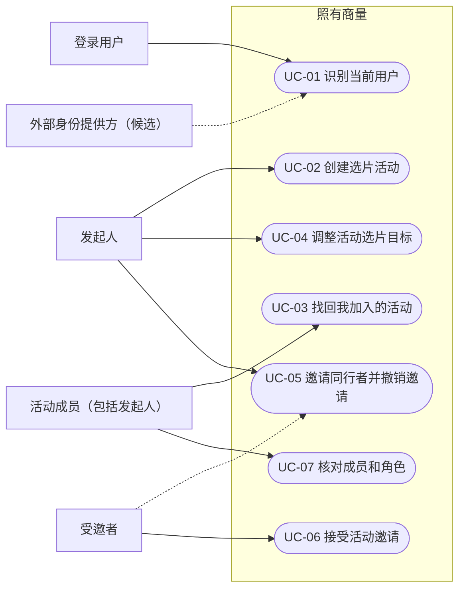
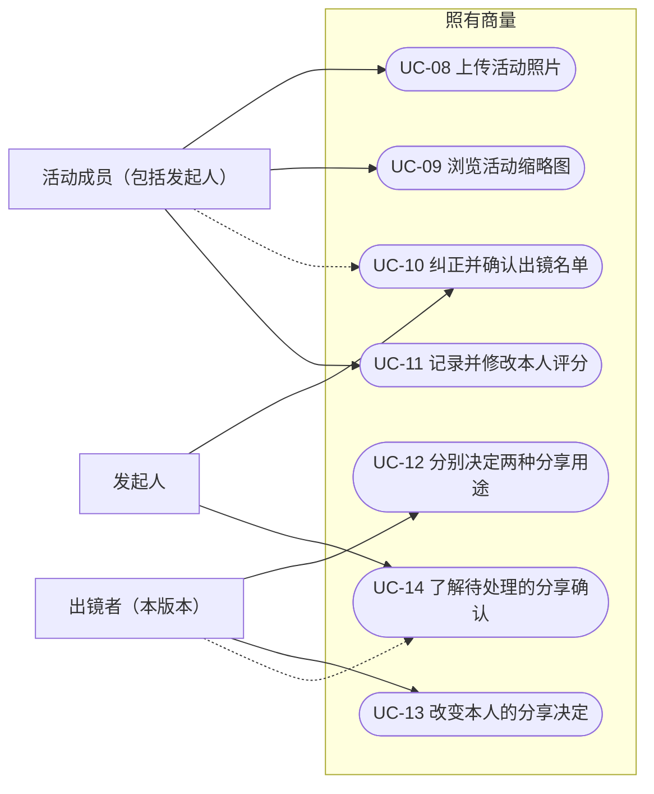
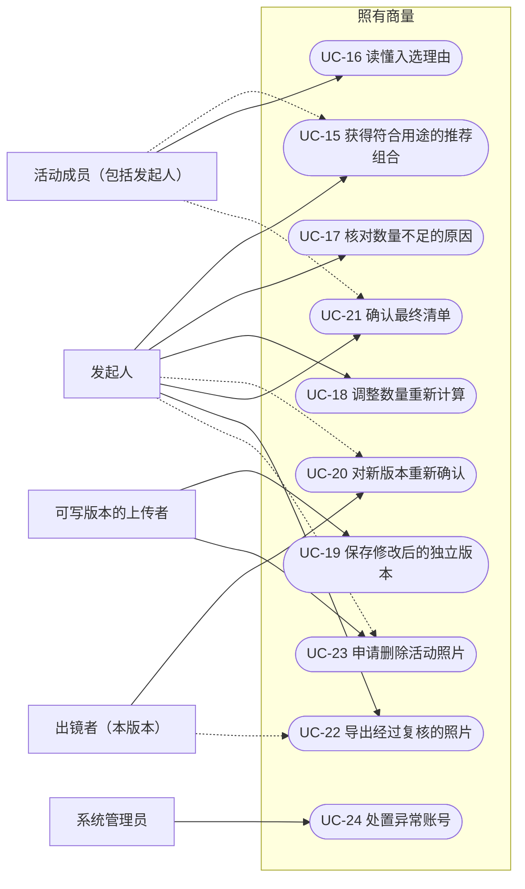

# 系统用例图 · 第 3 课评审稿

三个视图共享「照有商量」系统边界，按业务阶段展开全部 24 个功能用例。实线表示主参与者发起用例，虚线表示次参与者提供输入、协作或被征询。出镜者是特定照片版本中的活动成员。质量要求跨越多个用例，其对应关系见[追溯矩阵](13-traceability.md)。

## 活动与访问

## 照片与分享意愿

## 推荐、交付与管理

共享存储与数据库是内部技术组件。第三方登录为待选外部依赖，当前联调环境使用合成账号。课堂可沿 UC-12、UC-15、UC-22 逐一讲解授权、选择和交付。
