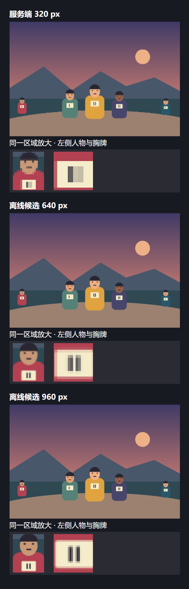

# 深色观片移动端验收

对应 [#74](https://github.com/Jdeciderz23/frame-and-say/issues/74)，复用 [#45 移动端流程](https://github.com/Jdeciderz23/frame-and-say/issues/45)、[#13 图片与权限检查](https://github.com/Jdeciderz23/frame-and-say/issues/13)，与 [#32 按用途授权](https://github.com/Jdeciderz23/frame-and-say/issues/32) 对齐。

## 合成活动夹具

按 [README](../../README.md) 启动本地 demo，并用 `scripts/init-env.sh` 准备两枚不同的本机联调令牌。保持前后端启动，在仓库根目录运行以下命令。状态文件使用一个尚不存在的路径，内容包括活动名、照片 ID、各版本 ID 和缩略图路径。

```sh
node --env-file=.env scripts/seed-dark-photo-viewer.mjs .cache/dark-viewer-74.json
```

脚本每次创建一个主活动和一个发起人专属的访问对照活动，建议在内存 H2 demo 中运行，重启即可清除夹具。主活动以「深色观片 74」开头，由 `organizer` 上传和确认名单，`participant` 是受邀成员和唯一出镜者。合照头像和胸牌均为人工绘制的合成图案。右边与左边分别有一位较小的出镜者。第二张为竖幅风景。三个 PNG 位于[夹具目录](../../scripts/fixtures/dark-photo-viewer)。

| 夹具 | 区分方式 | 确认名单 | 初始评分 | 初始群内 | 初始公开 |
| --- | --- | --- | --- | --- | --- |
| 合照 V1 | 2400×1600，中央人物穿紫红色 | `participant` | −1 | 拒绝 | 同意 |
| 合照 V2 | 2400×1600，中央人物穿黄色，与 V1 使用同一照片 ID | `participant` | 未评价 | 待确认 | 待确认 |
| 风景 V1 | 1600×2400，竖幅圆日和小路 | `participant` | 未评价 | 待确认 | 待确认 |

合照 V1 的评分与授权在 V2 保存前写入。保存 V2 时先核对名单仍未确认，然后单独确认 V2 的出镜名单，并断言它没有继承 V1 的评分与两个用途的授权。脚本还用匿名身份和未加入活动的 `participant` 核对缩略图分别返回 `401` 与 `403`。打开主活动后，始终用 `participant` 的令牌测试评价与分享决定。

## 手机复测步骤

将浏览器设为 375×667 CSS 像素，DPR 2。合照和风景在相册里的编号可能因 ID 排序变化，按照片内容或夹具输出的 ID 识别。

1. 从「我的活动」打开合成活动，再进入合照 V2。核对合照左右边缘都在画面内，默认未评价，两个分享用途都待确认，页面没有整页横向滚动。待 [#73](https://github.com/Jdeciderz23/frame-and-say/issues/73) 提供分支后，从活动封面进入观片，补查当前缩略图高亮与键盘焦点。
2. 在公开发布中选择同意，先不确认。现有页面用「返回照片列表」离开表单，再打开同一照片。公开决定应仍待确认，浏览器网络记录中没有发出 `PUT .../consents/me`。验收 #73 时，改用面板关闭或取消按钮重复此步。
3. 给合照 V2 评「一般」，确认群内同意、公开拒绝。刷新后仍停留在 V2，评分为 `0`，两个用途分别显示已同意与已拒绝。
4. 切到合照 V1，核对中央人物换回紫红色，复制详情地址并重新打开仍显示 V1。现有相册仅在当前版本提供评分和授权表单。再切到风景 V1，确认未评价、两个用途待确认，回到合照 V2 时原值仍在。
5. 在浏览器网络工具中临时屏蔽合照 V2 的 `thumbnailUrl`，重新进入详情，出现重试入口后解除屏蔽并重试。用 `participant` 打开状态文件记录的对照活动链接应提示无法访问；直接带该令牌请求 `nonMemberThumbnail` 预期为 `403`。

## 第一轮实测

2026-11-28（北京时间），基线 `b031e5f`，Windows + Edge 158 + 本地 Vite、Java 21 和 H2。前端 38 项测试和生产构建通过，后端 154 项测试通过。375×667、DPR 2 的 Edge 浏览器走查结果如下。

| 检查 | 实测结果 |
| --- | --- |
| 相册列表到照片详情 | 从「我的活动」进入，两张照片均可打开，详情焦点落到照片标题，页面无横向溢出。 |
| 评分、用途和刷新 | V2 刷新后仍为 `0 / INTERNAL_SHARE ALLOW / PUBLIC_POST DENY`，详情地址指向相同版本。 |
| 离开未提交的表单 | 公开发布仍为 `PENDING`，浏览器记录为 0 次授权写请求。 |
| 换图和换版 | V1 缩略图与 V2 字节不同，重新打开 V1 地址仍停在 V1，旧版本的授权读取返回 `409`。风景 V1 的 214×320 缩略图可解码，仍未评价且两个用途待确认。 |
| 图片故障和成员边界 | 注入 `503` 后出现重试入口，恢复请求后图片解码成功。非成员读图 `403`，匿名读图 `401`，已入组但非出镜的发起人提交分享决定 `403`。 |
| 深色封面、观片高亮和关闭面板 | 等 #73 提供可走查实现后复测。现有相册的离开表单结果可用作回归对照。 |

## 缩略图清晰度

合照由真实 API 返回 320×214 PNG，实际占 337.5 CSS 像素宽。DPR 2 对应约 675 个显示像素。原图两个边缘人物都没有被裁切，320 px 能看出群像和构图，但左侧胸牌的两道细线糊在一起。用同一合成原图在浏览器离线缩到 640×427 和 960×640，并按相同可见宽度展示。两者都能分开这两道线，960 px 的轮廓更清楚。以下图的局部放大只是为了看清三档差异。



建议前端继续用 320 px 做封面缩略图和浏览列表；如果观片要让成员辨认边缘小人脸、胸牌等细节，建议前后端先讨论最长边 640 px 的受保护预览，在高 DPR 真机或需要放大时再对照 960 px 与文件大小。预览应按活动、照片、版本核验成员权限，沿用匿名 `401`、非成员 `403`、资源不匹配或删除 `404` 以及 `Cache-Control: no-store`。当前比较只用合成图，最终尺寸、真实照片的清晰度和接口范围待 #73、#32 联合走查后确定。
