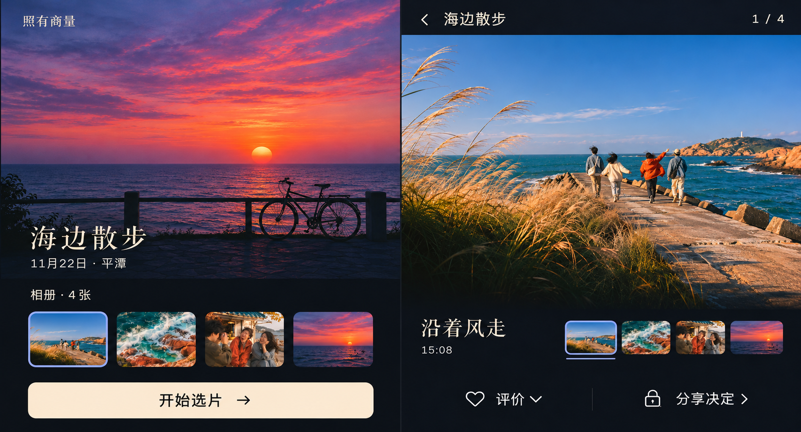
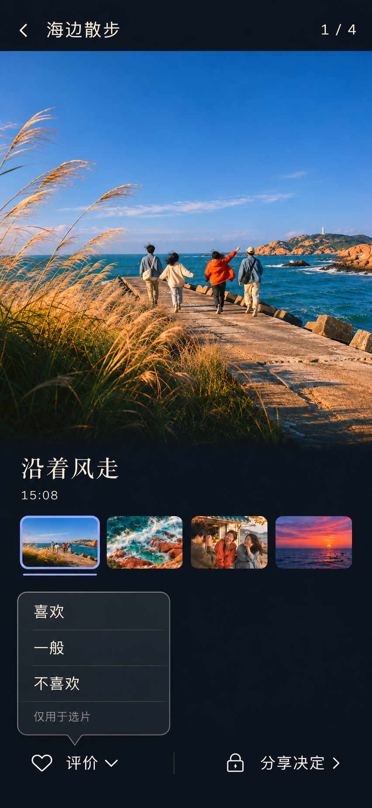
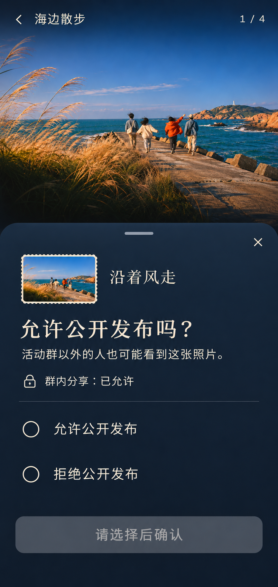

# 移动端设计方向 · 深色观片

「照有商量」的相册用活动照片做封面。进入观片页后，照片占据主要空间，操作留在手边，成员可以一路翻完，再回头表达偏好。后续前端以这三张参考图对齐视觉层次和交互。图中的人物与场景均为 AI 生成的示例素材。

## 打开相册，翻看大图

封面从本次活动选图，标题放在画面容易辨认的区域。参考图里，暮色中的自行车点出“海边散步”的气氛。下方的缩略图让成员一眼看到相册里还有什么，也可以直接点「开始选片」。

进入单张照片后，用深色背景衬托原图，配暖白文字。照片名和时间收成简短图注，缩略图标出当前照片。合照尤其要能看清边缘的出镜者。底部给「评价」和「分享决定」各留一个清楚可点的入口。

## 表达选片偏好

点「评价」才在入口附近展开「喜欢／一般／不喜欢」，选中后收起，成员可以接着翻图。首次打开保留未评价状态，用户主动选择「一般」才记录中间档。三档都只影响本人对当前照片版本的偏好。

## 确认分享用途

出镜者可直接进入「分享决定」，分别处理群内分享和公开发布。确认时保留照片预览，写明谁可能看到这张照片，再让本人选择并确认。首次决定时两项均留空，关闭面板保留原状态。

图中「群内分享：已允许」是这个例子里已有的个人决定，公开发布仍待确认。同一个人可以喜欢这张照片、允许群内分享，同时拒绝公开发布。照片换版或出镜名单修订后，按当前版本和修订重新确认。详见[个人评分](../11-srs.md#us-05)和[分享授权](../11-srs.md#us-06)。

## 留给实现的细节

字体家族、具体色值、字号与间距、圆角、缩略图尺寸、弹层形式和过渡动效，都可以结合照片和真机体验调整。真机评审时，看成员能否看清每位出镜者、顺手地翻到下一张，以及确认后能否说清自己刚刚允许了谁看哪张照片。

## 下一步怎样实现和验收

先从已有活动相册进入观片页，保留活动、照片和版本定位。王子轩负责封面、观片和两个操作入口，郭炫君配合核对按用途决定的状态。两人共同走查在同一张照片上给出「一般」、允许群内分享、拒绝公开发布后，刷新能否分别读回三个结果。[页面任务 #73](https://github.com/Jdeciderz23/frame-and-say/issues/73) · [授权任务 #32](https://github.com/Jdeciderz23/frame-and-say/issues/32)

现有照片接口返回受保护的缩略图，最长边为 320 像素。首轮用它对齐画面布局，完整保留合照边缘；图注可写「第 2 张，共 4 张」。示例里的照片名、拍摄时间只在具备相应业务数据后展示。周力扬在 375×667 的视口检验按钮、缩略图与人物清晰度，把需要更高清预览的具体场景记录到验收任务，再与后端约定尺寸和成员读取权限。[照片接口契约](../api/openapi.yaml) · [手机验收 #74](https://github.com/Jdeciderz23/frame-and-say/issues/74)

当周模型源文件、五人分工和交付日期见[深色观片与分析建模周计划](https://github.com/Jdeciderz23/frame-and-say/issues/75)。

合成活动、手机复测步骤和 320／640／960 px 清晰度对照见[移动端验收记录](dark-photo-viewer-validation.md)。
