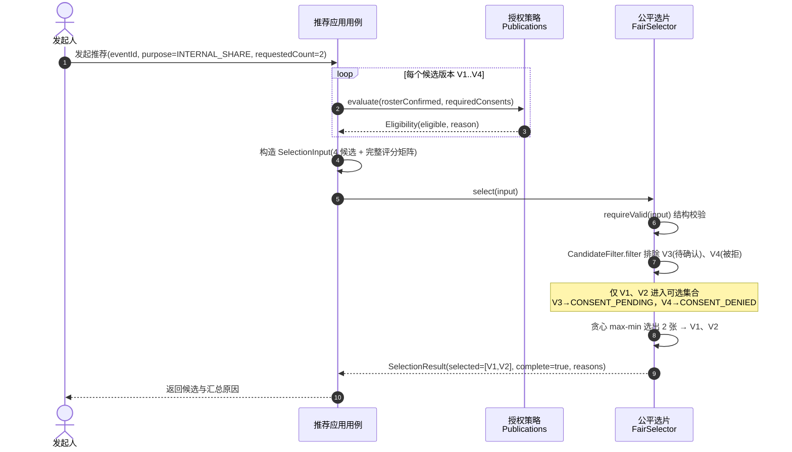

# 推荐流程顺序图 · UC-15

对应 [US-08 获得符合用途的推荐组合](../docs/09-user-stories.md) · UC-15 · 增量 3 · [#35](https://github.com/Jdeciderz23/frame-and-say/issues/35)。

本图覆盖「发起推荐 → 读取有效授权 → 返回候选」的完整链路。示例固定为一个用途（`INTERNAL_SHARE`）、目标两张、四个候选版本：两个已获全员许可、一个待确认、一个被拒且评分最高。授权结论只能由授权策略给出，选片算法只读取、不重算。

## 验收场景

四个候选版本对应四种授权结论：

| 版本 | 授权结论 | 评分（成员 a/b/c） | 结果 |
|---|---|---|---|
| V1 | `ELIGIBLE`（全员许可） | 1 / 0 / 0 | 入选 |
| V2 | `ELIGIBLE`（全员许可） | 0 / 1 / 0 | 入选 |
| V3 | `CONSENT_PENDING`（待确认） | 1 / 1 / 0 | 排除 |
| V4 | `CONSENT_DENIED`（被拒，评分总和最高） | 1 / 1 / 1 | 排除 |

V4 评分总和最高（3），但被拒后仍被硬约束排除；V3 待确认同样排除。两次运行结果一致、顺序一致。

## 输入 / 预期 / 实测

契约测试见 `FairSelectorTest.issue35TwoEligibleOfFourVersionsAreSelectedDeterministically`。

| 项 | 值 |
|---|---|
| 输入 | `eventId=event-35`、`purpose=INTERNAL_SHARE`、`requestedCount=2`、成员 `member-a/b/c`、4 个候选（上表）、完整评分矩阵 |
| 预期 | `selected=[v1, v2]`，`complete=true`，`v3`/`v4` 排除，`reasons=[AUTHORIZATION_REQUIRED×2]`，两次运行结果相等 |
| 实测 | 通过：`selectedPhotoVersionIds=[v1, v2]`，`complete=true`，`reasons` 为 `AUTHORIZATION_REQUIRED` 计数 2，`eligiblePhotoCount=2`、`minimumMemberUtility=0.0`、`totalMemberUtility=2.0`；两次 `select` 结果相等 |

## 追溯

| 需求 | 用例 | 模型元素（本图消息/生命线） | 代码 |
|---|---|---|---|
| US-08 | UC-15 | 发起推荐（发起人 → 应用用例） | 选片接口草案 `POST /api/events/{eventId}/selections`（OpenAPI `planned`） |
| | | 读取有效授权（`evaluate`） | [`Publications.evaluate`](../backend/src/main/java/com/groupphoto/consensus/authorization/Publications.java) |
| | | 结构校验（`requireValid`） | [`SelectionInputValidator`](../backend/src/main/java/com/groupphoto/consensus/recommendation/SelectionInputValidator.java) |
| | | 候选过滤（排除待确认/被拒） | [`CandidateFilter.filter`](../backend/src/main/java/com/groupphoto/consensus/recommendation/CandidateFilter.java) |
| | | 公平选择（贪心 max-min） | [`FairSelector.select`](../backend/src/main/java/com/groupphoto/consensus/recommendation/FairSelector.java) |
| | | 返回候选（`SelectionResult`） | [`SelectionResult`](../backend/src/main/java/com/groupphoto/consensus/recommendation/SelectionResult.java) |

输入输出契约详见[推荐输入输出契约](../docs/api/recommendation-dto.md)，需求追溯矩阵见[13-traceability](../docs/13-traceability.md)。
